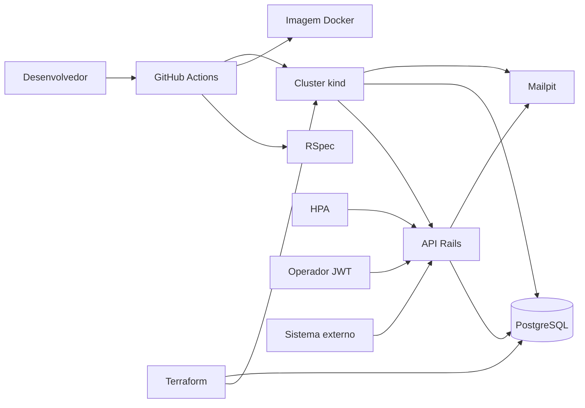

# Oficina API — Tech Challenge Fase 2

Evolução do monolito Rails 8 da fase 1 para uma oficina que precisa de fila operacional, notificação externa de orçamento, aviso de status por e-mail e um ambiente que sobe sozinho: Docker, Kubernetes com autoscaling, Terraform e pipeline de CI/CD.

O domínio da fase 1 permanece: cliente, veículo, catálogo, estoque e o ciclo da ordem de serviço (OS).

Recebida → Em diagnóstico → Aguardando aprovação → Em execução → Finalizada → Entregue

## Objetivos desta fase

- Manter a abertura da OS e a consulta de status.
- Receber aprovação ou recusa do orçamento como notificação externa.
- Listar a fila operacional na ordem pedida, sem apagar OS finalizada ou entregue.
- Avisar o cliente por e-mail a cada mudança de status.
- Subir a API e o PostgreSQL em Kubernetes, com HPA por CPU e memória.
- Provisionar o cluster local e o banco com Terraform.
- Rodar testes, build da imagem e deploy no cluster pela pipeline.

## Arquitetura



| Parte | Onde está | Função |
| --- | --- | --- |
| Domínio | `app/lib/domain` | CPF/CNPJ, placa, status, fila operacional, estoque, orçamento |
| Casos de uso | `app/lib/use_cases` | Abrir OS, transições, notificação externa, e-mail, listagem |
| Persistência | `app/models`, `db` | ActiveRecord e PostgreSQL |
| Interface | `app/controllers`, `app/mailers` | HTTP, JWT, webhook e e-mail |
| Execução local | `Dockerfile`, `docker-compose.yml` | API, PostgreSQL e Mailpit |
| Cluster | `k8s/` | Namespace, ConfigMap, Secret, banco, API, Mailpit, HPA e metrics-server |
| Infra | `infra/` | Cluster kind e deploy do PostgreSQL |
| Pipeline | `.github/workflows/ci-cd.yml` | Testes, imagem, Terraform, manifestos e fumaça da API |

### Fluxo de deploy

1. O push dispara a pipeline.
2. O job de testes sobe PostgreSQL, prepara o schema e roda o RSpec.
3. O job de deploy gera a imagem `oficina-api:local`.
4. O Terraform cria o cluster kind e aplica o PostgreSQL.
5. A imagem entra no cluster com `kind load`.
6. `k8s/apply.sh` aplica ConfigMap, Secret, banco, Mailpit, API, HPA e metrics-server.
7. A pipeline carrega o seed de demonstração, faz login e consulta a fila.

No computador, a mesma sequência está nos comandos de Kubernetes abaixo.

## APIs desta fase

Documentação interativa: [http://localhost:3000/api-docs](http://localhost:3000/api-docs) no Compose e [http://localhost:30080/api-docs](http://localhost:30080/api-docs) no cluster. A collection OpenAPI está em `swagger/v1/swagger.yaml`.

| Fluxo | Método | Quem chama |
| --- | --- | --- |
| Abrir OS | `POST /api/v1/admin/service_orders` | Operador, com JWT |
| Consultar status | `GET /api/v1/public/service_orders/:public_token` | Cliente |
| Fila operacional | `GET /api/v1/admin/service_orders` | Operador, com JWT |
| Notificação de orçamento | `POST /api/v1/integrations/budget_notifications` | Sistema externo, header `X-Integration-Token` |

A fila administrativa ordena assim: **Em execução**, **Aguardando aprovação**, **Em diagnóstico**, **Recebida**. Dentro de cada status, a OS mais antiga vem primeiro. Finalizada e entregue continuam no banco e na consulta pública do cliente, e saem só dessa listagem.

Aprovação e recusa públicas da fase 1 continuam em `/api/v1/public/service_orders/:public_token/approve` e `/reject`. O endpoint novo é a notificação externa:

```bash
curl -X POST http://localhost:3000/api/v1/integrations/budget_notifications \
  -H "Content-Type: application/json" \
  -H "X-Integration-Token: local-dev-integration-token" \
  -d '{"number":"OS-20240819-0001","decision":"approved","external_reference":"crm-100"}'
```

`decision` aceita `approved` ou `rejected`. A OS precisa estar em **Aguardando aprovação**. Cada transição, inclusive a abertura, envia e-mail para o endereço do cliente.

## Execução local

Requisitos: Docker com Compose.

```bash
docker compose up --build
docker compose exec app bundle exec rails db:seed
```

| Recurso | URL |
| --- | --- |
| API | http://localhost:3000 |
| Swagger | http://localhost:3000/api-docs |
| Healthcheck | http://localhost:3000/up |
| E-mails (Mailpit) | http://localhost:8025 |

| Campo | Valor |
| --- | --- |
| E-mail | `admin@oficina.test` |
| Senha | `oficina123` |
| Token de integração | `local-dev-integration-token` |

No Swagger, autorize o JWT como `Bearer <token>`.

```bash
docker compose --profile test run --rm test
docker compose down
```

## Deploy em Kubernetes

O cluster é Kubernetes na sua máquina, criado com kind. Não usa AWS. O `docker compose` da seção anterior continua sendo o ambiente de desenvolvimento, na porta 3000. Esta seção é o que o vídeo precisa mostrar além do Compose.

Requisitos: Docker, kubectl e os binários locais `kind` e `terraform` em `.tools/`. No terminal:

```bash
export PATH="$PWD/.tools:$PATH"
```

```bash
docker build --target runtime --build-arg BUNDLE_WITHOUT="development test" -t oficina-api:local .
terraform -chdir=infra init
terraform -chdir=infra apply
kind load docker-image oficina-api:local --name oficina
bash k8s/apply.sh
kubectl -n oficina exec deploy/oficina-api -- env SEED_DEMO=true bundle exec rails db:seed
```

| Recurso | URL |
| --- | --- |
| API | http://localhost:30080 |
| Swagger | http://localhost:30080/api-docs |
| Mailpit | http://localhost:30025 |

`terraform apply` cria o cluster e o PostgreSQL. `k8s/apply.sh` aplica o restante e espera a API ficar pronta. Para remover o cluster: `terraform -chdir=infra destroy`.

O Secret em `k8s/secret.yaml` usa senhas de demonstração, iguais ao Compose. Não use esses valores fora do challenge.

### O que o Terraform cria

| Recurso | Arquivo | Efeito |
| --- | --- | --- |
| Cluster kind `oficina` | `infra/main.tf` e `infra/kind-config.yaml` | Um nó control-plane, com as portas 30080 e 30025 publicadas no host |
| Namespace, Secret e PostgreSQL | `k8s/namespace.yaml`, `k8s/secret.yaml`, `k8s/postgres.yaml` | Banco `oficina_production` com volume persistente |

### O que os manifestos acrescentam

| Manifesto | Conteúdo |
| --- | --- |
| `k8s/configmap.yaml` | Ambiente não sensível, inclusive SMTP do Mailpit |
| `k8s/secret.yaml` | URL do banco, JWT, `SECRET_KEY_BASE` e token de integração |
| `k8s/mailpit.yaml` | Caixa de e-mail da demonstração |
| `k8s/app.yaml` | Deployment e Service NodePort 30080 da API |
| `k8s/hpa.yaml` | 1 a 5 réplicas, por CPU (60%) e memória (80%) |
| `k8s/metrics-server.yaml` | Métricas do HPA, com `--kubelet-insecure-tls` para o kind |

### Escalar na demonstração

Rode o seed antes. Para várias OS ao mesmo tempo:

```bash
BASE_URL=http://localhost:30080 bash script/simulate_peak.sh
```

Para o HPA aumentar as réplicas, gere CPU e acompanhe. O metrics-server leva cerca de um minuto para publicar métricas.

```bash
kubectl -n oficina top pods
bash script/stress_cpu.sh
kubectl -n oficina get hpa oficina-api -w
```

## CI/CD

O arquivo `.github/workflows/ci-cd.yml` faz, em todo push:

- build da aplicação Ruby e execução dos testes;
- build da imagem Docker de runtime;
- `terraform apply` do cluster e do banco;
- `kind load` da imagem;
- aplicação dos manifestos, inclusive o banco e o HPA;
- seed, login e consulta da fila dentro do cluster.

Pull request roda só os testes. O deploy aparece no push e também pode ser disparado manualmente em **Run workflow**.

## Testes

A suíte cobre o ciclo da fase 1 e, na fase 2, a ordem da fila, a exclusão lógica de finalizadas e entregues, o e-mail de status e a notificação externa (token inválido, aprovação com débito de estoque e recusa).

```bash
docker compose --profile test run --rm test
```

## Vídeo e entrega no portal

O que falar, em ordem e com o texto pronto, está em [ROTEIRO-VIDEO-FASE2.md](ROTEIRO-VIDEO-FASE2.md).

O documento para o portal, no mesmo formato da fase 1, é [Grupo110-Fase2-Derek-TechChallenge.pdf](Grupo110-Fase2-Derek-TechChallenge.pdf).

Grave um vídeo de até 15 minutos no YouTube ou Vimeo, público ou não listado, e substitua a linha abaixo.

**Vídeo da fase 2:** cole aqui o link depois de publicar.

No portal do aluno, envie o PDF da fase 2. Ele já traz o link do GitHub e o desenho da arquitetura. Depois de publicar o vídeo, troque a linha do vídeo nesse PDF. O repositório precisa estar compartilhado com o usuário **soat-architecture**.

Diagramas de domínio da fase 1: [Miro](https://miro.com/app/board/uXjVHsDM-SM=/?share_link_id=386665499309). Vídeo da fase 1: [YouTube](https://www.youtube.com/watch?v=RyrMkk2pN3Q). O PDF de arquitetura da fase 1 segue em `Grupo110-Fase1-Derek-TechChallenge-ArquiteturaSoftware.pdf`.

## Persistência

O banco continua sendo PostgreSQL 16. A OS, o cliente, o veículo e o estoque são relacionais: a aprovação debita peça dentro de transação com lock, e CPF, placa, SKU e número da OS são únicos. O Terraform e os manifestos sobem esse mesmo banco dentro do cluster, com volume persistente.

## Estrutura

```
app/lib/domain          regras de negócio, inclusive a fila operacional
app/lib/use_cases       abertura, transições, e-mail e notificação externa
app/mailers             e-mail de status
k8s/                    manifestos e apply.sh
infra/                  Terraform do cluster e do banco
.github/workflows/      pipeline
script/                 pico de OS e carga de CPU para o HPA
swagger/v1/swagger.yaml collection OpenAPI
```
